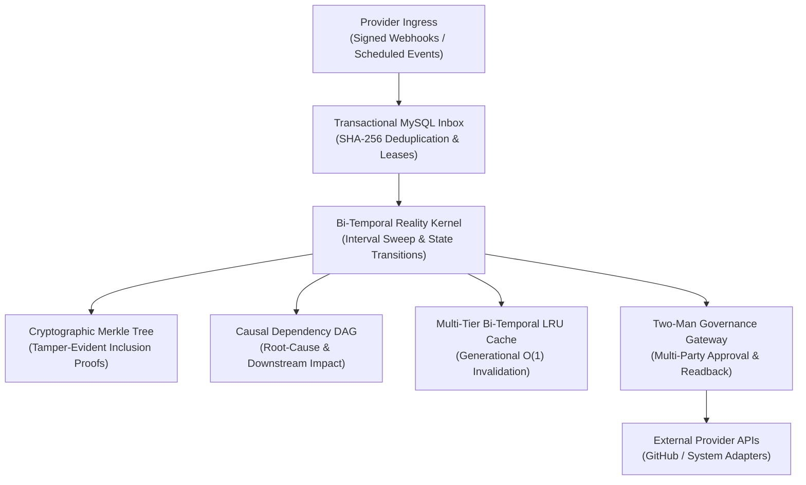

# Operant Architecture & System Specification

## 1. System Overview

Operant is a backend-first operational intelligence and governed execution fabric. The platform maintains a mathematically consistent, bi-temporal representation of organizational reality, ingests events through an idempotent transactional inbox, and guarantees human-in-the-loop authorization for provider mutations.

---

## 2. Bi-Temporal Reality Modeling

Reality is represented using two orthogonal temporal dimensions:

1. **Valid Time ($T_v$):** The interval $[t_{vs}, t_{ve})$ during which an operational fact or state actually holds in the physical or organizational domain.
2. **Knowledge Time ($T_k$):** The interval $[t_{ks}, t_{ke})$ during which the system was aware of the assertion.

### 2.1 State Assertion Tuples
An assertion $A$ is formalized as:
$$A = \langle \text{id}, \text{workspace\_id}, \text{entity\_id}, \text{attribute\_key}, \text{value}, [t_{vs}, t_{ve}), [t_{ks}, t_{ke}), \text{evidence\_id} \rangle$$

Where:
- $t_{vs} < t_{ve}$ (or $t_{ve} = \infty$ for currently open assertions).
- $t_{ks} < t_{ke}$ (or $t_{ke} = \infty$ for currently active assertions).
- Corrections do not overwrite existing tuples; they close the current assertion by setting $t_{ke} = t_{\text{correction}}$ and assert a successor tuple with $t_{ks} = t_{\text{correction}}$.

### 2.2 Point-in-Time Reconstruction ("As-Of" Query)
To reconstruct the operational state of entity $E$ at valid time $\tau_v$ as known by the system at transaction time $\tau_k$:
$$\text{State}(E, \tau_v, \tau_k) = \{ A \mid A.\text{entity\_id} = E \land \tau_v \in [A.t_{vs}, A.t_{ve}) \land \tau_k \in [A.t_{ks}, A.t_{ke}) \}$$

---

## 3. Algorithmic Specifications

### 3.1 Sweep-Line Temporal Interval Conflict Detection
Naive pairwise conflict detection requires $O(N^2)$ interval comparisons across $N$ assertions. Operant utilizes an $O(N \log N)$ sweep-line algorithm:

1. Transform each interval $I_i = [s_i, e_i)$ into two boundary events:
   - $\text{START}(s_i, I_i)$
   - $\text{END}(e_i, I_i)$
2. Sort events ascending by timestamp. To preserve half-open $[s, e)$ semantics, $\text{END}$ events precede $\text{START}$ events when timestamps are identical.
3. Traverse sorted events maintaining an active set $\mathcal{S}$.
   - On $\text{START}(s_i, I_i)$: evaluate collisions $\forall I_j \in \mathcal{S}$ sharing the same $(\text{entity\_id}, \text{attribute\_key})$. If $I_i.\text{value} \neq I_j.\text{value}$, emit a conflict record. Insert $I_i \to \mathcal{S}$.
   - On $\text{END}(e_i, I_i)$: remove $I_i$ from $\mathcal{S}$.

### 3.2 Cryptographic Merkle Reality Tree
To ensure tamper-evidence across distributed multi-instance deployments, all state assertions commit a deterministic SHA-256 leaf to a workspace Merkle tree:
$$\text{Leaf}_i = \text{SHA256}(\text{"LEAF:"} \parallel \text{CanonicalJSON}(A_i))$$
$$\text{Node}_{k} = \text{SHA256}(\text{"BRANCH:"} \parallel \text{Left} \parallel \text{Right})$$

Inclusion proofs allow zero-knowledge verification of historical assertions without full database scans:
$$\text{VerifyProof}(\text{Leaf}, \text{Proof}, \text{ExpectedRoot}) \in \{0, 1\}$$

### 3.3 Causal Dependency DAG
The causal engine structures operational state transitions as a directed acyclic graph $G = (V, E)$ where vertices $V$ represent events, evidence, assertions, obligations, and actions.
- **Topological Evaluation:** Computed via Kahn's algorithm in $O(|V| + |E|)$ time. If $\text{inDegree}$ reduction leaves non-zero vertices, a causal cycle is isolated and halted before execution.
- **Root-Cause Attribution:** Given a disputed state or action, backwards BFS over reverse adjacency edges isolates all root-level source events.

---

## 4. Multi-Tenant Isolation & Storage Architecture

- **Composite Key Mandate:** All tables enforce $(workspace\_id, id)$ primary and foreign key constraints. Single-column cross-table foreign keys are structurally prohibited.
- **Referential Integrity:** Operational event provenance enforces `ON DELETE RESTRICT` to prevent phantom assertions or orphaned audit rows.
- **Generational Cache Invalidation:** The bi-temporal LRU cache tracks a monotonically increasing generation counter per workspace. Any database mutation increments the generation, invalidating stale workspace snapshots in $O(1)$ time.
