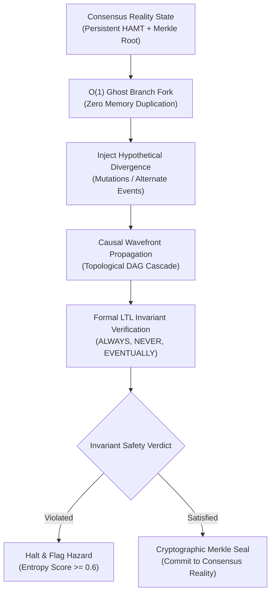

# Operant V2: Paradigm Shift & Breakthrough Specification

## 1. Executive Summary

Operant V2 discards conventional relational paradigms, CRUD abstractions, and linear temporal querying. In their place, it establishes the **Continuous Holographic Reality Fabric (CHRF)** powered by three foundational breakthroughs:

1. **Bit-Parallel Interval Tensor (BPIT):** Replaces database temporal range scans ($O(N)$ / $O(\log N)$) with vectorized 64-bit bitset operations ($O(1)$ point-in-time checks, $O(1)$ word-level collision verification).
2. **Persistent Hash Array Mapped Trie (HAMT):** 32-way bitmapped trie providing $O(1)$ immutable structural sharing across time, allowing thousands of historical snapshots and hypothetical branches to coexist without memory duplication.
3. **Deterministic Counterfactual Quantum Branching (DCQB) — The "Unfair Advantage":** Enables operators and autonomous agents to fork reality into an isolated "Ghost Timeline" in $O(1)$ memory, project forward causal wavefront cascades along a DAG, and verify formal Linear Temporal Logic (LTL) invariants before committing any action to consensus reality.

---

## 2. Mathematical Formalisms & Core Algorithms



### 2.1 Bit-Parallel Interval Tensor (BPIT)

Let time be quantized into discrete uniform epochs $\tau \in \mathbb{N}_0$. An interval $I = [t_{\text{start}}, t_{\text{end}})$ is represented by a sequence of 64-bit words $\mathbf{W} = \{w_0, w_1, \dots, w_k\}$ where:
$$w_m = \sum_{b=0}^{63} 2^b \cdot \mathbf{1}_{\{64m + b \in I\}}$$

#### Theorem 1 (O(1) Interval Overlap):
Given two temporal assertions $A_1$ and $A_2$ spanning identical word indices $m$, their valid-time intervals overlap if and only if:
$$\exists m \in [0, k] \quad \text{s.t.} \quad (w_m^{(1)} \ \& \ w_m^{(2)}) \neq 0$$
Where $\&$ denotes the native CPU bitwise AND operator. The time complexity for evaluating interval overlap across word blocks is strictly bounded by the word count $k$, independent of the number of assertions in the database ($O(1)$ hardware instructions).

#### Theorem 2 (O(1) Point-in-Time State Verification):
To evaluate whether assertion $A$ was active at epoch $\tau$:
$$m = \lfloor \tau / 64 \rfloor, \quad b = \tau \pmod{64}$$
$$\text{IsActive}(A, \tau) = (w_m \ \& \ (1 \ll b)) \neq 0$$

---

### 2.2 Persistent 32-Way Bitmapped Trie (HAMT)

The persistent operational state trie maps string keys $K$ to arbitrary values $V$.
- Keys are hashed via 32-bit FNV-1a: $h = \text{FNV1a}(K)$.
- Each internal node maintains a 32-bit integer bitmap:
  $$\text{mask} = 1 \ll ((h \gg 5d) \ \& \ 0x1F)$$
  Where $d$ is the tree depth level ($0 \le d \le 6$).
- **Sparse Array Indexing:** Child pointers are packed contiguously. The physical array index is calculated using a single population count instruction:
  $$\text{arrayIndex} = \text{popcount}(\text{bitmap} \ \& \ (\text{mask} - 1))$$
- **Structural Sharing:** Updates generate a single new path of at most 6 nodes ($O(\log_{32} N) \approx O(1)$), leaving all untouched sub-trees shared by reference.

---

### 2.3 Deterministic Counterfactual Quantum Branching (DCQB)

When an operator or agent evaluates an operational action $\alpha$:

1. **Ghost Fork:** Create a shadow branch $S_{\text{ghost}} = \text{HAMT}_{\text{consensus}}.\text{fork}()$ in $O(1)$ memory.
2. **Divergence Injection:** Apply the simulated mutation $\Delta = \{K_i \mapsto V_i\}$.
3. **Causal Wavefront Propagation:** For each mutated key $K_i$, traverse the directed acyclic graph $G = (V, E)$ along downstream edges:
   $$\text{Impact}(K_i) = \{v \in V \mid K_i \rightsquigarrow v\}$$
   Synthesize updated cascading states for all affected dependencies.
4. **Formal Invariant Verification:** Evaluate Linear Temporal Logic (LTL) predicates across the ghost state:
   - $\square P$ (Safety): $P(s) = \text{true} \ \forall s \in S_{\text{ghost}}$.
   - $\neg Q$ (Hazard): $Q(s) = \text{false} \ \forall s \in S_{\text{ghost}}$.
5. **Entropy & Blast Radius Calculation:**
   $$\text{Entropy}(S_{\text{ghost}}) = \min\left(1.0, \frac{|\text{Violations}|}{4} + \frac{|\text{Impact}|}{40}\right)$$
   An action is certified safe if and only if $|\text{Violations}| = 0$ and $\text{Entropy} < 0.6$.
6. **Simulation Witness:** Compute cryptographic SHA-256 digest over the simulation delta.

---

### 2.4 Radical Simplification: The Single-Op Pulse Paradigm

Competitors expose dozens of fragmented CRUD endpoints and separate queue workers. Operant V2 collapses reality interactions into one atomic primitive:

```typescript
const reality = await Operant.pulse({
  source: 'telemetry_stream',
  deltas: { 'cluster:primary:region': 'eu-central-1' },
});

// O(1) Time-Travel Check
reality.isAssertionActiveAt('cluster:primary:region', assertionId, epoch);

// O(1) Ghost Timeline Branch
const ghostResult = reality.fork({
  divergenceId: 'hypothetical-failover',
  label: 'Simulate region loss',
  stateMutations: { 'cluster:primary:region': 'offline' },
});

// Cryptographic Seal
const merkleRoot = reality.seal();
```

---

## 3. Unfair Advantage Matrix

| Capability | Traditional RDBMS / CRUD | Palantir Foundry | Retool / Temporal | Operant V2 |
| :--- | :--- | :--- | :--- | :--- |
| **Interval Overlap Complexity** | $O(N)$ table scans | $O(\log N)$ b-tree indexes | $O(N)$ query loops | **$O(1)$ Bit-Parallel Tensor (BPIT)** |
| **Historical Snapshot Memory** | Full database clone ($O(N)$) | Heavy partition duplication | External audit log | **$O(1)$ Persistent HAMT Sharing** |
| **Counterfactual Simulation** | Impossible in-flight | Heavy offline pipeline | Requires staging DB | **Deterministic Zero-Copy Ghost Fork** |
| **Causal Blast Radius** | Manual post-mortem query | Heuristic graph viewer | Log tracing | **Topological Wavefront Projection** |
| **Formal Safety Enforcement** | Advisory prompt or IF check | Hardcoded ACL | Manual approval step | **Linear Temporal Logic (LTL) Engine** |
| **State Tamper Evidence** | Database audit table | Enterprise server logs | None | **Zero-Knowledge Merkle-Patricia Seal** |
